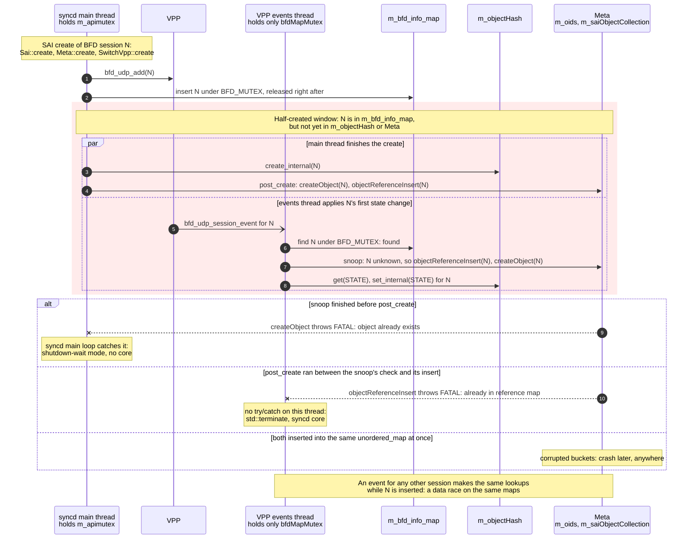

# saivpp: how VPP events become SAI notifications (port oper-status, BFD, FDB)

How the VPP backend of `libsaivs` (`SwitchVpp`, `sonic-sairedis/vslib/vpp/`) receives asynchronous events from VPP and turns
them into SAI notifications for syncd/orchagent, including the dedicated event socket + thread added by
[sonic-sairedis#1951](https://github.com/sonic-net/sonic-sairedis/pull/1951).

**Code baseline**: sonic-sairedis `8b5e2228` (2026-10-13; contains #1951 as `89f8e6e2` plus later rework such as the
interface registry, #2067), VPP `v27.02-rc0-14-g032ba959c`, sonic-swss `b8a9b654`.
Paths are relative to `sonic-sairedis/` unless prefixed with `vpp/` (VPP tree) or `orchagent/` (sonic-swss).

---

## TL;DR

* VPP mode produces three dataplane-driven notifications:

  | SAI notification | op on the `NOTIFICATIONS` channel | VPP source message |
  |---|---|---|
  | port oper status | `port_state_change` | `sw_interface_event` |
  | BFD session state | `bfd_session_state_change` | `bfd_udp_session_event` |
  | FDB learned / move / aged | `fdb_event` | `l2_macs_event` |
  | FDB flushed | `fdb_event` (`SAI_FDB_EVENT_FLUSHED`) | none, synthesized by vslib when the flush API is called |

* saivpp opens **two** binary-API client connections to `/run/vpp/api.sock`:
  * `sonic_vpp_api_client` (`vat_main`): synchronous request/reply **command** connection. **FDB MAC events are registered here.**
  * `sonic_vpp_event_client` (`vat_event_main`): **event** connection added by #1951. **Link and BFD events are registered here.**
* Link/BFD events are *polled*: the VPP events thread (`SwitchVpp::vppProcessEvents`) wakes every **2 s**, sends a
  `control_ping` on the event socket, and the reply-wait loop dispatches every event queued in front of the ping reply.
* Link/BFD events are also *applied* on that thread, **without `m_apimutex`**, so they race SAI calls on Meta and the
  switch state. A BFD event for a session whose create has not returned yet can stop or crash syncd (section 4.5).
* FDB events are *pushed* by VPP (L2FIB event scan every 10 ms) but are only *read* when some thread runs a VPP API call on
  the command connection (the handler runs inside that call's `WR()` loop). They are handed to the vslib FDB aging
  thread through `m_mac_event_queue`.
* All of them end in `SwitchStateBase::send_*_notification()` -> vslib event queue -> syncd `NotificationHandler` ->
  `NotificationProcessor` -> Redis pub/sub channel `NOTIFICATIONS` -> orchagent `PortsOrch` / `BfdOrch` / `FdbOrch`.
* A separate socket does **not** mean parallel VPP access: `EVENT_LOCK` and `VPP_LOCK` are the same recursive mutex,
  because the VPP client library's clib heap is process-global and not thread-safe.

---

## 1. End-to-end picture

```
                                        VPP (vpp_main)
         sw_interface_event   bfd_udp_session_event               l2_macs_event
         (edge: admin/link change, BFD transition)                (l2fib_scan, event_scan_delay = 10 ms)
                       |                                                 |
   event socket  "sonic_vpp_event_client"              command socket  "sonic_vpp_api_client"
   vat_event_main / event_socket_client_main           vat_main / socket_client_main
                       |                                                 |
 [VPP events thread] SwitchVpp::vppProcessEvents()     [any thread that is inside a VPP API call]
   every 2 s: vpp_sync_for_events()                      WR(): vl_socket_client_read()
     PING_EV + WR_EV dispatch handlers:                    vl_api_l2_macs_event_t_handler()
       vl_api_sw_interface_event_t_handler()                 -> SwitchVpp::staticMacEventCb()
       vl_api_bfd_udp_session_event_t_handler()                  push m_mac_event_queue
         -> vpp_ev_enqueue(vpp_evq)                              notify m_fdbAgingWakeEvent
   while (vpp_ev_dequeue()):                                         |
     VPP_INTF_LINK_STATUS -> asyncIntfStateUpdate()    [FDB aging thread] Sai::fdbAgingThreadProc()
     VPP_BFD_STATE_CHANGE -> asyncBfdStateUpdate()       wake or 1 s timeout -> MUTEX()
                       |                                 SwitchVpp::processFdbEntriesForAging()
                       |                                   generateFdbLearnedOrMoveEvent() / generateFdbAgedEvent()
                       v                                                 v
   send_port_oper_status_notification()                send_fdb_event_notification()
   send_bfd_state_change_notification()
                       +------------------------+------------------------+
                                                v
                 m_eventQueue <- Event(EVENT_TYPE_NOTIFICATION, EventPayloadNotification)
                                                v
              [vslib event-queue thread] Sai::asyncProcessEventNotification()
                ntf->executeCallback(sn) -> syncd NotificationHandler::on*()
                                                v
              [syncd notification thread] NotificationProcessor::syncProcessNotification()
                RID->VID, FDB -> ASIC_DB, port -> link-event damping
                                                v
                          Redis pub/sub channel "NOTIFICATIONS" (ASIC_DB)
                                                v
     orchagent: PortsOrch (port_state_change) | BfdOrch (bfd_session_state_change) | FdbOrch (fdb_event)
```

## 2. Per-notification summary

| | Port oper status | BFD session state | FDB learn / move / age |
|---|---|---|---|
| VPP subscription | `WANT_INTERFACE_EVENTS` | `WANT_BFD_EVENTS` | `WANT_L2_MACS_EVENTS2` (+ `L2FIB_SET_SCAN_DELAY`) |
| Registered by | `vpp_intf_events_enable_disable()` | `vpp_bfd_events_enable_disable()` | `vpp_want_l2_macs_events2()`, `vpp_l2fib_set_scan_delay()` |
| Registered from | `init_vpp_client()`, `vpp_event_reconnect()` | same | `SwitchVpp::initFdbEventHandling()` |
| Connection | event (`vat_event_main`) | event (`vat_event_main`) | command (`vat_main`) |
| xlate handler | `vl_api_sw_interface_event_t_handler` | `vl_api_bfd_udp_session_event_t_handler` | `vl_api_l2_macs_event_t_handler` |
| Hand-off | `vpp_evq` (`VPP_INTF_LINK_STATUS`) | `vpp_evq` (`VPP_BFD_STATE_CHANGE`) | `g_mac_event_cb` = `staticMacEventCb` -> `m_mac_event_queue` |
| Consumer thread | VPP events thread | VPP events thread | vslib FDB aging thread |
| SwitchVpp logic | `asyncIntfStateUpdate()` | `asyncBfdStateUpdate()` | `processFdbEntriesForAging()` |
| Holds `m_apimutex`? | **no** (section 4.5) | **no** (section 4.5) | yes |
| Recovery for lost events | level resync (`resyncPortOperStatus()`) | none | none |

## 3. Two binary-API connections (sonic-sairedis#1951)

### 3.1 Before and after

Before #1951 a single connection (`vat_main`) carried both request/reply traffic and the unsolicited
`sw_interface_event` / `bfd_udp_session_event` stream, and the events thread ran `vpp_sync_for_events()` on that same
connection under `VPP_LOCK`. Per the PR, this deadlocked between the command path and the async event path at
`PORT_COUNT=32` in the SAIVPP UT (`docker-sai-test-vpp`, #1950).

What the PR added (all in `vslib/vpp/vppxlate/SaiVppXlate.c` unless noted):

| Piece | Purpose |
|---|---|
| `event_socket_client_main` + `vat_event_main`, client name `sonic_vpp_event_client` | A second, fully independent client (own `client_index` and fd) connected with `vl_socket_client_connect2()`. It does not touch the global `socket_client_main` / `api_main->my_client_index` that belong to the command connection. |
| `M_EV` / `PING_EV` / `S_EV` / `WR_EV` | Same as `M` / `PING` / `S` / `WR`, but on an explicit `scm` through the `vl_socket_client_*2()` APIs. |
| `want_interface_events` and `want_bfd_events` issued on the event connection | VPP delivers those events only to the registering client, so the command socket stops seeing them. |
| `vpp_event_reconnect()` | Disconnect + reconnect + re-register interface and BFD events when the event socket fails (section 3.4). |
| `static __thread u16 __plugin_msg_base` | The message-id base chosen right before `M()` is per thread, so the two threads cannot race between "set base" and "build message". |
| `static __thread vat_main_t *tl_cur_vam` + `cur_vam()` | Reply handlers (`set_reply_status()`, `vl_api_control_ping_reply_t_handler()`) update the `vat_main_t` of the connection that is being read (default `&vat_main`). |
| `INTF_TABLE_LOCK()` | Leaf mutex around `sw_if_index_by_interface_name`, `interface_name_by_sw_index` and `link_speed_by_sw_index`, which both paths read/write. The event handler copies the interface name out under this lock. |
| Idle-deadline refresh in `WR` / `WR_EV` | Floods of unsolicited messages no longer time out the wait for the real reply (section 3.3). |
| Port oper-status level resync (`SwitchVppRif.cpp`, `SwitchVpp.cpp`) | `resyncPortOperStatus()` / `serviceDeferredOperStatusResync()` (section 4.3). |

### 3.2 Locking model (merged form)

* `vpp_mutex` is a **recursive** pthread mutex. `VPP_LOCK()` **and** `EVENT_LOCK()` both lock it.
  The PR description mentions "a separate lock for the event connection", but the merged code maps `EVENT_LOCK` onto
  `vpp_mutex`: both connections allocate messages on VPP's process-global, non-thread-safe clib heap, and concurrent
  allocations crashed (`os_panic in clib_mem_heap_realloc_aligned`). `vpp_event_mutex` is only kept as unused legacy.
* Recursive so that event registration/reconnect can nest inside `VPP_LOCK`.
* `INTF_TABLE_LOCK()` is a leaf lock: it may be taken while holding `VPP_LOCK`/`EVENT_LOCK`, never the other way round.
* Net effect: the dedicated socket isolates **traffic** (replies vs unsolicited events, client index, socket buffers);
  it does not add **concurrency**. A 2 s event poll and a SAI command never talk to VPP at the same time.

### 3.3 How replies (and events) are read: `WR()` / `WR_EV()`

There is no reader thread in the VPP client library. A message is dispatched to its `vl_api_*_t_handler` only when some
thread calls `vl_socket_client_read()` / `vl_socket_client_read2()`, which in `SaiVppXlate.c` happens **only** inside
`WR()` (command connection) and `WR_EV()` (event connection). Every complete message in the buffer is dispatched,
solicited or not:

```
hard_deadline = start + 10 s;  idle_deadline = start + 1 s;  ret = -99
loop:
    if now >= hard_deadline or now >= idle_deadline: break       # ret stays -99 (timeout)
    rv = vl_socket_client_read[2](1)                             # dispatches every buffered message
    if rv == 0: idle_deadline = min(now + 1 s, hard_deadline)    # anything read -> extend idle window
    if WR_EV and rv < 0: ret = rv; break                         # socket error -> caller reconnects
    if vam->result_ready: ret = vam->retval; break               # set by the reply handler
    vat_suspend()                                                # 100 ms nanosleep in this file
```

### 3.4 Event-socket failure and reconnect

```
vpp_sync_for_events():                        # called by the events thread every 2 s
    if !event_client_connected:
        if vpp_event_reconnect() != 0: return -1
    EVENT_LOCK(); tl_cur_vam = &vat_event_main; __plugin_msg_base = memclnt base
    PING_EV; S_EV; WR_EV(ret)                 # all queued events are dispatched before the ping reply
    tl_cur_vam = NULL; EVENT_UNLOCK()
    if ret < 0: vpp_event_reconnect()         # disconnect2 -> connect2 -> want_interface_events -> want_bfd_events
    return ret
```

* `ret < 0` includes the `-99` timeout: a ping with no reply within the 1 s idle window is handled like a socket error.
* `vppProcessEvents()` treats `ret < 0` as "edges may have been lost" and requests a port oper-status resync.
* If `init_vpp_event_client()` failed at startup ("async events disabled"), every 2 s cycle retries the connect.
* `want_l2_macs_events2` is **not** re-registered (it lives on the command socket), and the command socket itself has
  no reconnect logic.

## 4. Link and BFD events (VPP events thread)

### 4.1 Startup order

```
syncd create_switch -> VirtualSwitchSaiInterface::init_switch()
  +- new SwitchVpp(...) -> vpp_dp_initialize()
  |    +- init_vpp_client()                                      # SaiVppXlate.c
  |    |    +- vsc_socket_connect("sonic_vpp_api_client")
  |    |    +- api_sw_interface_dump()                           # interface name/index/speed tables
  |    |    +- vpp_evq_init()                                    # before any event source is enabled
  |    |    +- init_vpp_event_client()                           # "sonic_vpp_event_client"; only if it succeeds:
  |    |    +- vpp_intf_events_enable_disable(true)              #   WANT_INTERFACE_EVENTS on event socket
  |    |    +- vpp_bfd_events_enable_disable(true)               #   WANT_BFD_EVENTS on event socket
  |    |    +- vpp_bfd_udp_enable_multihop()
  |    +- m_vpp_thread = std::thread(&SwitchVpp::vppProcessEvents)
  +- ss->initFdbEventHandling(m_fdbEventFn)                      # FDB, section 5
```

### 4.2 The poll loop (`SwitchVpp::vppProcessEvents`, `SwitchVppRif.cpp`)

```cpp
m_operResyncDue = true;                         // startup resync request (section 4.3)
while (m_run_vpp_events_thread) {
    nanosleep(2 s);
    ret = vpp_sync_for_events();                // handlers fill vpp_evq
    if (ret < 0) m_operResyncDue = true;        // event socket failed -> edges may be lost
    while ((evp = vpp_ev_dequeue())) {
        if (evp->type == VPP_INTF_LINK_STATUS) {
            if (link_up) vpp_refresh_interface_speed(hwif);   // command socket, VPP_LOCK
            asyncIntfStateUpdate(hwif, link_up);
        } else if (evp->type == VPP_BFD_STATE_CHANGE) {
            asyncBfdStateUpdate(&evp->data.bfd_notif);
        }
        vpp_ev_free(evp);
    }
}
```

* `vpp_evq` is an unlocked singly linked list. That is fine because producer (handlers) and consumer run on the same
  thread: after init only the events thread reads the event socket, and during init the command thread reads it before
  the events thread exists.
* The loop also *applies* the events: `asyncIntfStateUpdate()` and `asyncBfdStateUpdate()` run on this thread without
  `m_apimutex`, racing SAI calls (section 4.5).
* Reporting latency for link/BFD changes is up to one poll interval (2 s) plus processing. VPP's own BFD detection is
  not affected, only the report to orchagent.
* `~SwitchVpp()` clears `m_run_vpp_events_thread` and joins, which can take one sleep + one sync.

### 4.3 Port oper status

**Handler** (`vl_api_sw_interface_event_t_handler`):

* `sw_if_index` -> hwif name through `interface_name_by_sw_index` (copied out under `INTF_TABLE_LOCK`). An unknown
  index is dropped.
* Events with **admin up and link down** are discarded (`return`). Otherwise `link_up = flags & LINK_UP`. The reported
  state is therefore the hardware link flag, and the admin flag only matters for the drop rule. This filter has been
  there since the original VPP merge (#1473):

  | admin | link | handler result |
  |---|---|---|
  | up | up | UP |
  | up | down | dropped: carrier loss on an admin-up port is not reported by this path |
  | down | down | DOWN |
  | down | up | UP |

**`SwitchVpp::asyncIntfStateUpdate()`** (events thread, holds neither `m_apimutex` nor a VPP lock):

* `m_ifaceRegistry.resolvePhysicalPortOid(hwif)`. Only physical ports carry SAI oper status: `BondEthernet*`, BVIs and
  sub-interfaces are ignored. syslog still shows `Received port link event for BondEthernet101 state DOWN` because the
  loop logs every dequeued link event, whether or not `asyncIntfStateUpdate()` used it.
* `send_port_oper_status_notification(port_oid, state, false)`.

**`SwitchStateBase::send_port_oper_status_notification()`** (generic vslib):

* `meta->meta_sai_on_port_state_change()`.
* De-duplication: if the cached `SAI_PORT_ATTR_OPER_STATUS` already equals the new state (and `force` is false), stop.
* Needs a non-NULL `SAI_SWITCH_ATTR_PORT_STATE_CHANGE_NOTIFY` pointer.
* `update_port_oper_status()` -> `set(SAI_PORT_ATTR_OPER_STATUS)`, then enqueue `NotificationPortStateChange`.
* A `get(SAI_PORT_ATTR_OPER_STATUS)` returns this cache. VPP is not queried (`refresh_read_only()` returns success for
  this attribute). Default ports created at switch init start as `DOWN` (`SwitchStateBase::create_ports()`). Ports
  created later through SAI start as `UNKNOWN` unless the caller passes a value (`SwitchVpp::createPort()`).

**Level resync (#1951)**. VPP interface events are edge-triggered: an edge that happens while nobody is subscribed
(before subscription, or while the event socket is broken) is gone. The resync reads the level instead:

* Requested (`m_operResyncDue = true`) when the events thread starts and after any `vpp_sync_for_events()` failure. It is
  deliberately not periodic: per the PR, a per-cycle resync of per-interface `SW_INTERFACE_DUMP`s exhausted the VPP client
  clib heap.
* Serviced by `serviceDeferredOperStatusResync()` at the top of `SwitchVpp::create()`, `remove()` and `set()`.
  `exchange(false)` makes it one-shot.
* `resyncPortOperStatus()` walks `m_hostif_info_map` (LCP tap name -> `HostInterfaceInfo`), maps tap -> hwif with
  `m_ifaceRegistry.resolveHwIfByOsIf()`, and reads `interface_get_state()` (an `SW_INTERFACE_DUMP` on the command
  socket; it uses the LINK_UP flag only, without the admin filter above). It skips ports whose state equals
  `m_last_oper_up[tap]`; otherwise it records the state, calls `send_port_oper_status_notification()` and logs
  `resync oper-status <hwif>(<tap>) UP|DOWN`.

**The generic netlink path is wired but filtered out.**

* `sai_vpp.profile` sets `SAI_VS_HOSTIF_USE_TAP_DEVICE=true`, so `SwitchState` registers with `NetMsgRegistrar`:
  `RTM_NEWLINK` -> `SwitchState::asyncOnLinkMsg()` -> `EVENT_TYPE_NET_LINK_MSG` -> `Sai::syncProcessEventNetLinkMsg()`
  (under `MUTEX()`) -> `SwitchStateBase::syncOnLinkMsg()`, which maps `IFF_LOWER_UP` to UP/DOWN.
* linux-cp mirrors the phy's hardware link state onto the tap carrier
  (`vpp/src/plugins/linux-cp/lcp_interface.c`: `lcp_itf_pair_link_up_down()` -> `tap_set_carrier()`), so this path would
  see the carrier loss that the VPP handler drops.
* #1870 added `SwitchVpp::register_hostif_info()`, which records the tap ifindex so that `SwitchVpp::hasIfIndex()`
  matches it. But `syncOnLinkMsg()` then requires the ifname to be in the lane map or to start with `v`. VPP taps are
  named `EthernetN` and `lanemap.ini` lists `ethN`, so every event ends in
  `ERR syncd#syncd#syncd: :- syncOnLinkMsg: skipping newlink for Ethernet112, name not found in map`.
* Observed on `vlab-vpp-05` (`master.1248213-e34fc82b0`, built 2026-10-15):

  | syslog line (all rotated files) | count |
  |---|---|
  | `skipping newlink for Ethernet...` | 2727 |
  | `newlink: ifindex: ...` (accepted by the netlink path) | 0 |
  | `Received port link event for ...` (VPP event path) | 593 |
  | `send event SAI_SWITCH_ATTR_PORT_STATE_CHANGE_NOTIFY ...` | 479 |
  | `resync oper-status ...` | 0 |

  In practice, VPP-mode port oper status comes from the VPP event path only.

### 4.4 BFD session state

* Session create (`SwitchVpp::vpp_bfd_session_add()`, command thread): `bfd_udp_add()`, then under `BFD_MUTEX`
  (`bfdMapMutex`) `m_bfd_info_map[{multihop, local_addr, peer_addr}] = bfd_oid`. `vpp_bfd_session_del()` erases it after
  `bfd_udp_del()`. The session is in the map before `create_internal()` and Meta's post_create run (section 4.5).
* Handler (`vl_api_bfd_udp_session_event_t_handler`): `multihop = (sw_if_index == ~0)`, converts local/peer
  address, and enqueues `VPP_BFD_STATE_CHANGE`.
* `SwitchVpp::asyncBfdStateUpdate()` (events thread):
  * maps VPP state to SAI: `ADMIN_DOWN`, `DOWN`, `INIT`, `UP`; anything else becomes `DOWN`;
  * looks up the oid under `BFD_MUTEX`. An unknown session is logged (`Existing bfd object not found`) and dropped;
  * otherwise calls `send_bfd_state_change_notification(oid, state, false)`. This de-dups against the cached
    `SAI_BFD_SESSION_ATTR_STATE`, calls `update_bfd_session_state()` (-> `set()`) and enqueues
    `NotificationBfdSessionStateChange`.
* `get(SAI_BFD_SESSION_ATTR_STATE)` returns the cached value (`SwitchVpp::refresh_read_only()`).
* After an event-socket reconnect, BFD events are re-subscribed but there is no BFD level resync. A transition that
  happened during the outage is only reported at the next transition.

### 4.5 Race: link and BFD events are applied without `m_apimutex`

Meta (`meta/Meta.cpp`) and the switch state (`SwitchStateBase`) have no locks of their own. vslib serializes them with
its API lock, `Sai::m_apimutex` (`MUTEX()`): every SAI call takes it, and so do the other event paths (netlink and
packet events on the vslib event-queue thread, `Sai::processFdbEntriesForAging()` on the FDB aging thread). The VPP
events thread is the exception: `asyncIntfStateUpdate()` runs with no lock, `asyncBfdStateUpdate()` with only
`bfdMapMutex`.

| Lock | Protects | syncd main thread, creating BFD session N | VPP events thread, applying a BFD event |
|---|---|---|---|
| `m_apimutex` | Meta, switch state | held for the whole create | not held |
| `bfdMapMutex` (`BFD_MUTEX`) | `m_bfd_info_map` only | held only around the map insert | held across `asyncBfdStateUpdate()`, notification included |
| `vpp_mutex` (`VPP_LOCK` / `EVENT_LOCK`) | VPP client calls only | inside `bfd_udp_add()` | released when `vpp_sync_for_events()` returns, before events are applied |

Containers both threads use with no lock in common:

| Container | Type | syncd main thread | VPP events thread |
|---|---|---|---|
| Meta `m_oids` (`OidRefCounter::m_hash`) | `unordered_map<oid, refcount>` | `meta_generic_validation_post_create()` inserts N and bumps the refcounts of N's OID attributes (e.g. its VR) | snoop in `meta_sai_on_bfd_session_state_change_single()`: looks N up, inserts it if missing |
| Meta `m_saiObjectCollection` (`SaiObjectCollection::m_objects`) | `unordered_map<meta key, SaiObject>` | post_create inserts N | snoop: looks N up, `createObject(N)` |
| `m_objectHash[SAI_OBJECT_TYPE_BFD_SESSION]` | `map<serialized oid, AttrHash>` | `create_internal()` inserts N | `get()` and `set_internal()` look sessions up |
| a session's `AttrHash` | `map<attr name, shared_ptr<SaiAttrWrap>>` | `create_internal()` fills N's attributes | `set_internal()` writes `SAI_BFD_SESSION_ATTR_STATE` |

* Link events follow the same pattern on ports: Meta's port snoop (`meta_sai_on_port_state_change_single()`), then
  get/set of `SAI_PORT_ATTR_OPER_STATUS` in the port's `AttrHash`, while the main thread may be setting other
  attributes of that port.
* If an oper-status resync is pending, the events thread's `set()` runs `resyncPortOperStatus()` itself (caveat 4),
  walking `m_hostif_info_map` while hostif creates modify it.
* Not affected: `m_bfd_info_map` itself (both sides lock it), the outer per-type level of `m_objectHash` (filled for
  every object type in the `SwitchState` constructor and never resized), the vslib event queue (own mutex),
  `m_ifaceRegistry` (internally locked) and `objectTypeQuery()` (decodes the OID bits). `SwitchState` declares an
  `m_mutex`, but no code locks it.

#### The half-created window

`SwitchVpp::create()` for BFD session N, all under `m_apimutex`:

1. `bfd_udp_add()`: N exists in VPP, which can now report its state.
2. `m_bfd_info_map[key] = N` under `BFD_MUTEX`, released right after (`vpp_bfd_session_add()`).
3. `create_internal()`: N enters `m_objectHash` (`bfd_session_add()`).
4. Back in `Meta::create()`, `meta_generic_validation_post_create()`: N enters `m_saiObjectCollection` and `m_oids`.

From step 2 the events thread finds N in `m_bfd_info_map`, but N reaches `m_objectHash` only at step 3 and Meta only at
step 4. A state event for N in that window runs `send_bfd_state_change_notification()`:

* Meta does not know N, so it snoops it in: `objectReferenceInsert(N)`, then `createObject(N)`.
* `get(STATE)` and `set(STATE)` miss N in `m_objectHash` before step 3 and only log errors.



How it ends depends on the interleaving:

* **Snoop done before step 4**: post_create logs `object key ... already exists (vendor bug?)`, then `createObject()`
  throws `FATAL: object ... already exists` on the main thread. syncd's main loop catches it
  (`Runtime error: ... - entering shutdown-wait mode`): no core, but syncd stops.
* **Step 4 between the snoop's check and its insert**: the snoop's `objectReferenceInsert()` throws
  `FATAL: object oid 0x... already in reference map` on the events thread. `vppProcessEvents()` has no try/catch:
  `std::terminate`, abort, syncd core.
* **Both insert into the same `unordered_map` at once**: corrupted buckets, crash later, anywhere.

The window itself is narrow: VPP only reports transitions, and a new session stays in Down, with no event, until the
peer answers (100 peerless sessions, created 3 times on `vlab-vpp-05`, produced no event). So N's first transition has
to land between steps 1 and 4.

#### Other sessions

The containers are shared by all sessions. While the main thread creates session 57, the events thread can be applying
session 3's UP event; its lookups in `m_oids` and `m_objectHash[BFD_SESSION]` then run during session 57's inserts into
the same maps. That is undefined behavior on its own:

* an `unordered_map` insert can rehash, freeing the bucket array the lookup is walking: the lookup can read freed
  memory, or miss an entry that exists;
* a missed entry makes Meta snoop a session it already has, and the re-check inside `objectReferenceInsert()` can
  throw on the events thread: the same abort as above.

Remove has no half-removed window: `vpp_bfd_session_del()` erases the map entry right after `bfd_udp_del()`, before
`remove_internal()` and Meta's post_remove, and the erase waits for `bfdMapMutex` while the events thread is notifying.
Data races remain, though: before the erase it reads N's attributes with `get()`, which can overlap the events thread
inserting N's first `SAI_BFD_SESSION_ATTR_STATE` into the same `AttrHash`, and the later erases from `m_objectHash` and
Meta race with lookups for other sessions.

#### How often, and the fix

* `bfd/test_bfd.py::test_bfd_scale` creates exactly this load: it starts PTF's bfdd first, then creates all sessions in
  one `swssconfig` batch, so the first sessions can come up while the rest are still being created.
* With the 2 s sleep (section 4.2), events are applied in one batch every 2 s and rarely overlap the creates. Over the
  21 days before 2026-10-19, ~1,366 `t1-lag-vpp` PR test plans had one other `test_bfd_scale` failure (a
  `sonic-buildimage-msft` 202607 PR, #3257, on 2026-09-30), also with a syncd core.
* [sonic-sairedis#2133](https://github.com/sonic-net/sonic-sairedis/pull/2133) wakes the events thread as soon as VPP
  writes to the event socket (`poll()`), so events are applied within milliseconds, while the creates are still
  running. In the `t1-lag-vpp` run of
  [sonic-buildimage#30204](https://github.com/sonic-net/sonic-buildimage/pull/30204), which pinned #2133 before the
  fix, `test_bfd_scale` crashed syncd in all 3 attempts (core `syncd.1792431135.67.core.gz`; log analyzer is off for
  that test, so syncd's last error lines were not captured).
* The fix, in the same PR: the events thread only posts each event on the vslib event queue, as
  `EVENT_TYPE_PLATFORM_EVENT`, and the vslib event-queue thread applies it with `MUTEX()` held:
  `Sai::syncProcessEventPlatformEvent()` -> `VirtualSwitchSaiInterface::syncProcessEventPlatformEvent()` (drops it if
  the switch is gone) -> `SwitchVpp::syncOnPlatformEvent()`. That is the path netlink link events already take. An
  event for N then waits until N's create has returned. The link-speed refresh stays on the events thread; MAC events
  keep going to the FDB aging thread.
* Taking `m_apimutex` on the events thread instead would deadlock: `remove_switch` holds it while `~SwitchVpp()` joins
  that thread.

## 5. FDB events (command socket + FDB aging thread)

### 5.1 What VPP sends, and when (`vpp/src/vnet/l2/`)

Registration happens at switch creation. `Sai::startFdbAgingThread()` passes a wake functor to
`VirtualSwitchSaiInterface::initFdbEventHandling()`, which stores it and applies it to every switch, including ones created
later. That reaches `SwitchVpp::initFdbEventHandling()`:

1. `m_fdbAgingWakeFn = fn` is set first, because a MAC event can fire as soon as the registration returns.
2. `vpp_l2fib_set_scan_delay(1)` sets `event_scan_delay = 1 x 10 ms`.
3. `vpp_want_l2_macs_events2(true, staticMacEventCb, this)` with `max_macs_in_event = 10`. VPP multiplies that by 10, so
   one `l2_macs_event` carries up to 100 MACs.

Notes:

* Both VPP handlers (`l2fib_set_scan_delay`, `want_l2_macs_events2`) call `l2fib_flush_all_mac()`, so registering
  flushes every dynamic MAC.
* VPP supports a single MAC-event client at a time, keyed by pid (`l2learn_main.client_pid`). Another pid gets
  `VNET_API_ERROR_L2_MACS_EVENT_CLINET_PRESENT`; the same pid just replaces `client_index`. On the saivpp side the
  callback is a process-global (`g_mac_event_cb`) and `vpp_want_l2_macs_events2()` asserts a single switch.
* For socket clients `vl_api_can_send_msg()` always returns 1, so VPP never drops MAC events for saivpp. Unread events
  queue up in the client's socket output buffer.

What `l2fib_mac_age_scanner_process()` / `l2fib_scan()` emit:

| Trigger in VPP | Event |
|---|---|
| New MAC (L2FIB miss in `l2-learn`) sets `LRN_EVT` | `ADD` at the next event scan (<= 10 ms) |
| MAC seen on a different `sw_if_index` sets `LRN_EVT` + `LRN_MOV` | `MOVE` |
| MAC refreshed on the same interface | nothing |
| Entry older than the BD's `mac_age` | `DELETE`. **Never happens with saivpp**: `vpp_bridge_domain_add_del()` leaves `mac_age = 0`, and nothing maps `SAI_SWITCH_ATTR_FDB_AGING_TIME`. |
| Entry made stale by an L2FIB flush (`l2fib_flush_int/bd/all`; also done by VPP itself on admin-down of a bridged interface or when it leaves bridge mode) | `DELETE`, during the one-pass age scan the flush kicks off |

### 5.2 saivpp processing

```
VPP l2fib_scan --l2_macs_event--> command socket ("sonic_vpp_api_client")
  ... read only inside WR() of the next VPP API call on vat_main (any thread, under VPP_LOCK)
vl_api_l2_macs_event_t_handler()            # ntohl(action) (see below), chunks of 128 entries
  -> SwitchVpp::staticMacEventCb()
       lock m_mac_event_queue_mutex; push VppMacEvent{mac, sw_if_index, action}
       m_fdbAgingWakeFn() -> Sai::m_fdbAgingWakeEvent.notify()          # eventfd
Sai::fdbAgingThreadProc()                   # select(wake event | stop event, 1 s timeout)
  -> Sai::processFdbEntriesForAging()       # MUTEX() = m_apimutex
     -> VirtualSwitchSaiInterface::ageFdbs() -> SwitchVpp::processFdbEntriesForAging()
          swap the queue out under m_mac_event_queue_mutex
          gate: m_ifaceRegistry.findBySwIfIndex(sw_if_index)->hasBdId(), else WARN + drop
          key = {mac, bd_id}            (bd_id == VLAN ID)
          ADD    : key not in m_vpp_fdb_entries -> generateFdbLearnedOrMoveEvent(LEARNED), else skip
          DELETE : key in m_vpp_fdb_entries     -> generateFdbAgedEvent(),                  else skip
          MOVE   : generateFdbLearnedOrMoveEvent(MOVE)   (becomes LEARNED if the entry is unknown)
```

* `generateFdbLearnedOrMoveEvent()`:
  * `resolveIfOid(sw_if_index)` walks a sub-interface up to its parent PORT/LAG oid.
  * `findBridgeVlanForPortVlan(port, bd_id)` returns `bv_id` + `bridge_port_id`.
  * LEARNED calls `create_internal(FDB_ENTRY, {TYPE=DYNAMIC, BRIDGE_PORT_ID})`; MOVE calls
    `set_internal(BRIDGE_PORT_ID)`. Then it updates `m_fdb_info_set` and calls `send_fdb_event_notification()`.
* `generateFdbAgedEvent()`: finds the entry in `m_fdb_info_set`, calls `remove_internal()`, erases it and sends `AGED`.
* `m_vpp_fdb_entries` (`{mac, bd_id} -> sw_if_index`) is only a de-dup snapshot of what has been reported. It is
  invalidated on flush (section 5.3), and `vpp_fdbentry_del()` erases a key when orchagent deletes an FDB entry, so a later
  re-learn is reported again.
* `bd_id` is attached to the interface record by `swif_bdid_track()` when a port joins a VLAN and cleared by
  `swif_bdid_untrack()`. Without it, every event from that interface is dropped (`FDB: dropping MAC event for untracked
  sw_if_index ...`).
* `action` is a 4-byte enum in network order. Before the `ntohl()` fix, `DELETE` (1) and `MOVE` (2) were truncated to
  0 = `ADD`, so aged/flushed MACs came back as LEARNED.
* syncd `process_on_fdb_event()` translates RIDs to VIDs, writes the entry to ASIC_DB (`redisPutFdbEntryToAsicView()`)
  and publishes `fdb_event`.

### 5.3 Flush

```
orchagent FdbOrch::flushFDBEntries(bridge_port, vlan) -> sai_fdb_api->flush_fdb_entries()
  -> VirtualSwitchSaiInterface::flushFdbEntries()
       remove matching entries from m_objectHash[FDB_ENTRY] and m_fdb_info_set
       SwitchVpp::vpp_fdbentry_flush()        -> VPP l2fib_flush_* + vpp_fdb_entries_invalidate_*
       send_fdb_event_notification(FLUSHED)   # one consolidated event per entry type,
                                              # mac 00:00:00:00:00:00, bv_id / BRIDGE_PORT_ID from the flush attrs
VPP one-pass age scan -> DELETE for every flushed MAC -> saivpp: "FDB: DELETE for unknown MAC ... skipping"
Next frame from the host -> ADD -> LEARNED
```

How `vpp_fdbentry_flush()` maps orchagent's attribute combinations (`FLUSH_BY_INTERFACE = 1`, `FLUSH_BY_BD_ID = 2`,
`FLUSH_ALL = 4`; orchagent always adds `ENTRY_TYPE = DYNAMIC`):

| orchagent caller | Attrs | Mode | VPP action |
|---|---|---|---|
| `FLUSHFDBREQUEST` op `ALL` (`sonic-clear fdb all` / `fdbclear`) | none | 4 | `l2fib_flush_all()` |
| port oper down (`updatePortOperState`), learn on a down port, `FLUSHFDBREQUEST` op `PORT` (`fdbclear -p`) | BRIDGE_PORT_ID | 5 | `l2fib_flush_int(hwif)` |
| `FLUSHFDBREQUEST` op `VLAN` (`fdbclear -v`) | BV_ID | 6 | `l2fib_flush_bd(attr.value.u16)`. BV_ID is an **OID**, see caveat 8. |
| VLAN member removal (`updateVlanMember`), `FLUSHFDBREQUEST` op `PORTVLAN` (`fdbclear -p -v`) | BRIDGE_PORT_ID + BV_ID | 7 | `l2fib_flush_all()`: the whole L2FIB |

### 5.4 When do MAC events actually get read?

* Only `WR()` reads the command socket, so an `l2_macs_event` is dispatched only when some thread runs a binary-API
  request on `vat_main`. Examples: a SAI create/set/remove that programs VPP (syncd main thread),
  `vpp_refresh_interface_speed()` on a link-up (events thread), or the oper-status resync.
* Port, policer and route counters are read from the VPP stats segment (`SaiVppStats.c`, `stat_segment_*`), so counter
  polling does **not** drain the API socket.
* On an otherwise idle switch, a learned MAC therefore waits in VPP's socket buffer until the next command. The 10 ms
  scan delay is a lower bound, not the end-to-end latency. The code acknowledges this: there is a TODO in
  `SwitchVpp::staticMacEventCb()` to move MAC events to a separate event socket.
* The handler can run on a thread that holds `VPP_LOCK` but not `m_apimutex` (for example the events thread inside
  `vpp_refresh_interface_speed()`), while the command thread holds `m_apimutex` and waits for `VPP_LOCK`. That is why
  `staticMacEventCb()` only touches `m_mac_event_queue_mutex` and an eventfd: taking `m_apimutex` there could deadlock.

## 6. Common output path: vslib -> syncd -> orchagent

1. `send_*_notification()` (vslib):
   * calls `meta->meta_sai_on_*()` to keep the vslib metadata DB in sync;
   * reads the callback pointer from the switch attribute (`SAI_SWITCH_ATTR_PORT_STATE_CHANGE_NOTIFY`,
     `SAI_SWITCH_ATTR_FDB_EVENT_NOTIFY`, `SAI_SWITCH_ATTR_BFD_SESSION_STATE_CHANGE_NOTIFY`). syncd replaced orchagent's
     pointers with its own in `NotificationHandler::updateNotificationsPointers()` on switch create/set;
   * builds a `sairedis::Notification*` and enqueues `Event(EVENT_TYPE_NOTIFICATION, EventPayloadNotification)` on
     `m_switchConfig->m_eventQueue`.
2. vslib event-queue thread: `Sai::eventQueueThreadProc()` -> `Sai::asyncProcessEventNotification()` ->
   `ntf->executeCallback(sn)` -> `NotificationHandler::onPortStateChange()` / `onFdbEvent()` /
   `onBfdSessionStateChange()`. No API mutex is taken here, unlike the packet and netlink events, which use `MUTEX()`.
3. syncd: `NotificationHandler::enqueueNotification()` -> `NotificationQueue` -> notification thread ->
   `NotificationProcessor::syncProcessNotification()`:
   * `process_on_port_state_change()`: RID -> VID, then optional link-event damping;
   * `process_on_fdb_event()`: RID -> VID for switch / `bv_id` / bridge port, plus `redisPutFdbEntryToAsicView()`;
   * `process_on_bfd_session_state_change()`: RID -> VID;
   * `sendNotification()` -> `RedisNotificationProducer` -> channel `NOTIFICATIONS`.
4. orchagent: `NotificationConsumer(ASIC_DB, "NOTIFICATIONS")` with op allow-lists. `PortsOrch` takes
   `port_state_change`, `FdbOrch` takes `fdb_event`, `BfdOrch` takes `bfd_session_state_change`.

## 7. Threads and locks cheat sheet

| Thread | Started by | Reads VPP via | Locks taken | Event work |
|---|---|---|---|---|
| syncd main (command) | syncd | command socket (`WR`) | `m_apimutex` -> `vpp_mutex` -> `INTF_TABLE_LOCK` | SAI create/set/remove; services the oper-status resync; may dispatch `l2_macs_event` |
| VPP events | `vpp_dp_initialize()` | event socket (`WR_EV`) every 2 s; command socket on link-up speed refresh | `vpp_mutex`, `INTF_TABLE_LOCK`, `bfdMapMutex`. **Not** `m_apimutex` (section 4.5) | `asyncIntfStateUpdate()`, `asyncBfdStateUpdate()` |
| vslib FDB aging | `Sai::startFdbAgingThread()` | none | `m_apimutex`, `m_mac_event_queue_mutex` | `SwitchVpp::processFdbEntriesForAging()` |
| vslib event queue | `Sai::startEventQueueThread()` | none | none for notifications | runs syncd callbacks |
| `NetMsgRegistrar` | singleton | netlink | none | `SwitchState::asyncOnLinkMsg()` -> enqueue |
| syncd notification | `NotificationProcessor::startNotificationsProcessingThread()` | none | syncd mutex | RID -> VID, ASIC_DB, publish |

Lock order: `m_apimutex` -> `vpp_mutex` (`VPP_LOCK` == `EVENT_LOCK`) -> `INTF_TABLE_LOCK` (leaf).
`bfdMapMutex` -> `vpp_mutex` is possible through `set()` -> `serviceDeferredOperStatusResync()`.
`m_mac_event_queue_mutex` is a leaf.

## 8. Caveats and gaps found while reading the code

These come from reading the code at the baseline above. Only the items backed by `vlab-vpp-05` data (the netlink, link
event and resync syslog counts, and the `sairedis.rec` timing) were observed on a DUT. Caveat 5 also crashed syncd in
CI (section 4.5).

1. **Admin-up carrier loss is not reported.** `vl_api_sw_interface_event_t_handler` drops admin-up/link-down, and the
   netlink fallback is filtered out (section 4.3). Note that the resync reads LINK_UP without this filter, so the two
   paths disagree on that state.
2. **The startup resync is effectively a no-op.** The flag is set when the events thread starts (inside create_switch)
   and is consumed by the next `create/set/remove`, long before orchagent creates the hostifs, so `m_hostif_info_map` is
   still empty. In `vlab-vpp-05`'s `sairedis.rec` the first `set` comes 0.3 s after the SWITCH create, while the first
   HOSTIF create comes 2.3 s after it, on line 866 of the recording. syslog has 0 `resync oper-status` lines. Only the
   reconnect-triggered resync can do anything.
3. **`m_last_oper_up` goes stale.** Only `resyncPortOperStatus()` writes it, never `asyncIntfStateUpdate()`. Example:
   the resync records UP, an event reports DOWN, then the link comes back UP during an event-socket outage. The
   post-reconnect resync reads UP, equal to the stale UP, and skips the port, so SONiC stays DOWN.
   `send_port_oper_status_notification()` already de-dups against the cached SAI attribute, so the extra cache is not
   needed. Fixed in #2133: `m_last_oper_up` is removed, and the resync skips a port only if VPP's link state equals the
   cached `SAI_PORT_ATTR_OPER_STATUS`, which link events update too.
4. **The deferred resync is not guaranteed to run on the command thread.** `update_port_oper_status()` and
   `update_bfd_session_state()` call the virtual `set()`, and `SwitchVpp::set()` services the resync first, so the
   events thread can run it. This is safe for the VPP client heap (one recursive mutex) but contradicts the stated intent.
   After a reconnect it can also run too early: inside the `set()` of the first event applied, before the link events
   read before the failure, whose older states then land after the resync's. And if no SAI write follows a reconnect,
   the resync waits. Fixed in #2133: the reconnect queues a `VPP_INTF_LINK_RESYNC` event behind the events already read
   (`vpp_intf_events_resync()`), and the vslib event-queue thread applies those first, then runs `resyncPortOperStatus()`
   under `MUTEX()`. `m_operResyncDue` is left only for the startup request (caveat 2).
5. **The events thread mutates switch state and Meta without `m_apimutex`.** `send_port_oper_status_notification()` and
   `send_bfd_state_change_notification()` snoop objects into Meta and read/write `m_objectHash` (OPER_STATUS / STATE
   through `set()`), concurrently with SAI calls on the command thread. The netlink and FDB paths take `MUTEX()` for the
   same kind of work. A BFD event for a session whose create has not returned yet can stop or crash syncd (section 4.5).
6. **FDB events ride the command socket.** Delivery latency depends on command traffic (section 5.4), and they are not
   covered by the event-socket reconnect. There is a TODO in `staticMacEventCb()`.
7. **There is no timer-based FDB aging.** `mac_age` stays 0, `SAI_SWITCH_ATTR_FDB_AGING_TIME` is not mapped, and
   `SwitchVpp::processFdbEntriesForAging()` replaces the generic software ager. `AGED` is only reported when a VPP-side
   flush scan deletes a key that is still in `m_vpp_fdb_entries`.
8. **Flush scope does not match the request.** VLAN-only flush uses `attr.value.u16` of `SAI_FDB_FLUSH_ATTR_BV_ID` (a
   VLAN OID) as the BD id, so VPP flushes the wrong BD. Port+VLAN flush (every VLAN member removal) flushes the whole
   VPP L2FIB and the whole `m_vpp_fdb_entries`, while ASIC_DB / `m_fdb_info_set` keep the non-matching entries. When
   those MACs re-learn, `create_internal()` fails with `SAI_STATUS_ITEM_ALREADY_EXISTS` and the key is not re-added to
   the snapshot, so a later VPP `DELETE` for it is ignored (only a `MOVE` puts it back).
9. **Minor: memory leak in the BFD handler.** `vl_api_bfd_udp_session_event_t_handler` leaks the `calloc`'d
   `vpp_event_info_t` when address conversion fails.

## 9. Debugging

* syslog (`/var/log/syslog*`):
  * `vppProcessEvents: Received port link event for <hwif> state UP|DOWN`
  * `vppProcessEvents: Received bfd state change event, multihop:..., sw_idx:..., state N`
  * `send event SAI_SWITCH_ATTR_PORT_STATE_CHANGE_NOTIFY for port oid:...: SAI_PORT_OPER_STATUS_*`
  * `send event SAI_SWITCH_ATTR_BFD_SESSION_STATE_CHANGE_NOTIFY for bfd session oid:...: SAI_BFD_SESSION_STATE_*`
  * `FDB: registered for VPP L2 MAC push events`, `FDB: notified LEARNED|MOVE|AGED for MAC ...`,
    `FDB: dropping MAC event for untracked sw_if_index ...`
  * `resync oper-status ...`, `vpp_sync_for_events failed (...); event socket reconnect attempted`
  * `Checking for any VS events status <ret>`: NOTICE every 2 s, `0` = OK
  * `syncOnLinkMsg: skipping newlink for EthernetN, name not found in map`: expected noise (section 4.3)
  * `data.bfd_session_id new object spotted oid:... not present in local DB (snoop!)`: Meta got a BFD event for a
    session it did not know, normally one whose create had not returned (section 4.5). Then either
    `object key SAI_OBJECT_TYPE_BFD_SESSION:oid:... already exists (vendor bug?)`, `FATAL: object ... already exists`
    and `Runtime error: ... entering shutdown-wait mode` (syncd stops), or
    `FATAL: object oid 0x... already in reference map` and a syncd core (`/var/core/syncd.*.core.gz`).
* VPP:
  * `vppctl show api clients` (run in the syncd container: `docker exec syncd vppctl ...`): two socket clients,
    `sonic_vpp_api_client` and `sonic_vpp_event_clie` (VPP cuts names to 20 characters). Map them to the owning
    process (syncd) by peer inode:
    `sudo ss -xpH | awk '$5=="/run/vpp/api.sock" {peer[$8]=1} {own[$6]=$0} END {for (p in peer) print own[p]}'`.
  * `vppctl show l2fib`: when entries exist it prints
    `L2MAC events client PID: <syncd pid> ... Delay: 1.00e-02sec  Max macs in event: 100`.
  * `vppctl show bfd sessions`, `vppctl show interface`, `vppctl show hardware-interfaces`.
* Notifications on the wire: `redis-cli -n 1 SUBSCRIBE NOTIFICATIONS`. orchagent's recording in
  `/var/log/swss/sairedis.rec` has `|n|port_state_change|...`, `|n|fdb_event|...` and
  `|n|bfd_session_state_change|...` lines.

## References

* [sonic-sairedis#1951](https://github.com/sonic-net/sonic-sairedis/pull/1951): dedicated binary-API socket and thread
  for asynchronous VPP events
* [sonic-sairedis#1950](https://github.com/sonic-net/sonic-sairedis/pull/1950): SAIVPP unit-test harness
  (`docker-sai-test-vpp`), where the deadlock was hit
* [sonic-sairedis#1934](https://github.com/sonic-net/sonic-sairedis/pull/1934): VPP FDB support
  (`WANT_L2_MACS_EVENTS2`); background in [fdb_dev_notes_2026_06_07.md](./fdb_dev_notes_2026_06_07.md)
* [sonic-sairedis#1870](https://github.com/sonic-net/sonic-sairedis/pull/1870): VPP hostif registration for netlink
  link-state updates
* [sonic-sairedis#2133](https://github.com/sonic-net/sonic-sairedis/pull/2133): MAC events on the event connection,
  events thread woken by `poll()`, event-socket reconnect fix with FDB and link state resync (caveats 3 and 4), and the
  fix for the race in section 4.5
* [sonic-buildimage#30204](https://github.com/sonic-net/sonic-buildimage/pull/30204): VPP PR checkers on #2133;
  `test_bfd_scale` syncd cores in Elastictest plan
  [6ad63b660a3ef5b4434395f1](https://elastictest.org/scheduler/testplan/6ad63b660a3ef5b4434395f1)
* Code: `vslib/vpp/vppxlate/SaiVppXlate.c`, `vslib/vpp/SwitchVppRif.cpp`, `vslib/vpp/SwitchVpp.cpp`,
  `vslib/vpp/SwitchVppFdb.cpp`, `vslib/vpp/SwitchVppBfd.cpp`, `vslib/SaiFdbAging.cpp`, `vslib/SaiEventQueue.cpp`,
  `vslib/SwitchStateBase.cpp`, `meta/Meta.cpp`, `meta/OidRefCounter.cpp`, `meta/SaiObjectCollection.cpp`,
  `syncd/NotificationHandler.cpp`, `syncd/NotificationProcessor.cpp`; VPP `src/vnet/l2/l2_fib.c`, `l2_learn.c`, `l2_api.c`
